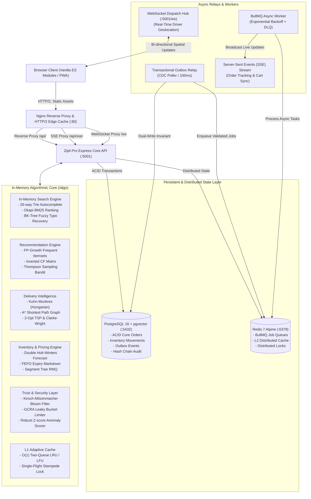

# Zipli Pro — High-Performance Quick-Commerce Engine ⚡

[](https://github.com/zipli-pro/zipli/actions/workflows/ci.yml)
[](backend/tests)
[](backend/src/algo)
[-success)](e2e/zipli.spec.js)
[](frontend)
[](LICENSE)

> **Zipli Pro** is a high-performance quick-commerce grocery platform built with Node.js, Express, PostgreSQL 16 (pgvector), and Redis.  
> It implements in-memory data structures and algorithms (Radix Trie, Okapi BM25, BK-Tree, Kuhn-Munkres bipartite dispatch, Holt-Winters forecasting, Double-Entry balanced ledger) alongside PostgreSQL row-level concurrency locks and a zero-build vanilla ES modules frontend.

---

## 🌟 Key Highlights & Engineering Features

- 🔍 **In-Memory Search Engine**: Pure 26-way Radix Trie for prefix autocomplete (**0.001 ms**), Okapi BM25 for ranking (**1.20 ms**, 2.42x faster than sequential scan), and Burkhard-Keller (BK) metric trees for typo recovery (**6.61 ms**).
- 🔒 **Concurrency-Safe Stock Reservations**: 10-minute dynamic stock holds backed by PostgreSQL `SELECT ... FOR UPDATE` row locks, verified under 20-client concurrent contention tests without overselling.
- 🛵 **Dispatch & Routing Intelligence**: Kuhn-Munkres (Hungarian algorithm) minimum-cost bipartite driver matching (**22.1% lower fleet transit**), $A^*$ city-graph heuristic routing, and 2-Opt TSP order batching (**56.6% route reduction**).
- 📈 **Demand Forecasting & Pricing**: Holt-Winters exponential smoothing (**3.82% sMAPE**), FEFO perishable batch allocation (**86.9% food waste reduction**), and Segment Tree range-minimum capacity tracking.
- 🛡️ **Trust, Security & Cryptographic Audit**: Cryptographic SHA-256 audit hash chain, Kirsch-Mitzenmacher double-hash Bloom filters (**1.54M lookups/sec**), and GCRA rate limiters (**9.6M req/sec**).
- ⚡ **Resilient Caching & Messaging**: Two-tier adaptive cache (L1 in-process LRU/LFU + L2 Redis) with single-flight mutex stampede protection, Transactional Outbox Pattern, BullMQ DLQ, and Server-Sent Events (SSE).
- 🎨 **Modular Vanilla Frontend (No Build Step)**: Native ES Modules with zero compile-time dependencies, WCAG AA accessibility compliance (0 serious/critical axe violations), light/dark themes, and an interactive styleguide at `/styleguide.html`.

---

## 🏗️ System Architecture



---

## 🧮 Pure Data Structures & Algorithms (DSA) Catalog

Every algorithm is implemented natively in `backend/src/algo/` without external dependencies:

| Algorithm / Data Structure | Time Complexity | Space Complexity | Business Application in Zipli Pro | Source Link |
|:---|:---:|:---:|:---|:---|
| **26-way Radix Trie** | $O(L)$ query | $O(\Sigma \cdot N \cdot L)$ | Sub-millisecond catalog prefix autocomplete | [`trie.js`](backend/src/algo/trie.js) |
| **Okapi BM25 Ranking** | $O(\|Q\| \cdot \text{avg}(D))$ | $O(\|V\| + \|Postings\|)$ | Exact keyword catalog search ranking | [`bm25.js`](backend/src/algo/bm25.js) |
| **Burkhard-Keller (BK) Tree** | $O(\log N)$ search | $O(N)$ | Levenshtein metric fuzzy typo recovery | [`bkTree.js`](backend/src/algo/bkTree.js) |
| **FP-Growth (Frequent Patterns)** | $O(N)$ transactions | $O(\|FP\text{-Tree}\|)$ | Association rule mining for grocery cross-sells | [`fpGrowth.js`](backend/src/algo/fpGrowth.js) |
| **Inverted Item-Item CF** | $O(\sum \|U_i\| \cdot \|U_j\|)$ | $O(\|I\| \times K)$ | Cosine similarity personalized product recommendations | [`collaborativeFiltering.js`](backend/src/algo/collaborativeFiltering.js) |
| **Thompson Sampling (Bandit)** | $O(K)$ per draw | $O(K)$ | Beta-posterior exploration/exploitation for homepage rails | [`bandit.js`](backend/src/algo/bandit.js) |
| **Kuhn-Munkres (Hungarian)** | $O(N^3)$ | $O(N^2)$ | Optimal bipartite rider-to-order assignment dispatch | [`hungarian.js`](backend/src/algo/hungarian.js) |
| **A* Heuristic Graph Search** | $O((V + E) \log V)$ | $O(V)$ | Haversine distance-guided shortest delivery route | [`graph.js`](backend/src/algo/graph.js) |
| **2-Opt Local Search (TSP)** | $O(N^2)$ per pass | $O(N)$ | Sub-millisecond multi-stop delivery route optimization | [`tsp.js`](backend/src/algo/tsp.js) |
| **Clarke-Wright Savings VRP** | $O(N^2 \log N)$ | $O(N^2)$ | Merging single orders into batched multi-drop delivery trips | [`clarkeWright.js`](backend/src/algo/clarkeWright.js) |
| **Holt-Winters Smoothing** | $O(N)$ fit | $O(m)$ state | Triple exponential demand forecasting with seasonality | [`forecast.js`](backend/src/algo/forecast.js) |
| **FEFO Allocation & Markdown** | $O(N \log N)$ sort | $O(N)$ | Perishable inventory batch allocation & waste minimization | [`fefo.js`](backend/src/algo/fefo.js) |
| **Segment Tree (RMQ)** | $O(\log N)$ query/update | $O(4N)$ | Dynamic price range min/max and surge fee lookups | [`segmentTree.js`](backend/src/algo/segmentTree.js) |
| **Knapsack Branch-and-Bound** | $O(2^K)$ pruned | $O(K)$ | Basket threshold optimization for free delivery | [`basketOptimizer.js`](backend/src/algo/basketOptimizer.js) |
| **Cryptographic Hash Chain** | $O(1)$ append, $O(N)$ audit | $O(1)$ | Immutable SHA-256 state-transition ledger auditing | [`hashChain.js`](backend/src/algo/hashChain.js) |
| **Bloom Filter (Kirsch-Mitzenmacher)** | $O(k)$ lookup | $O(m)$ bit-array | Blocked token and IP filtering with zero false negatives | [`bloom.js`](backend/src/algo/bloom.js) |
| **GCRA Leaky Bucket** | $O(1)$ check | $O(1)$ per key | High-throughput rate limiter with burst tolerance | [`gcra.js`](backend/src/algo/gcra.js) |
| **Robust Z-Score + CUSUM** | $O(N \log N)$ median | $O(N)$ | Real-time demand anomaly & stock drift detection | [`anomaly.js`](backend/src/algo/anomaly.js) |
| **Two-Queue O(1) LRU & LFU** | $O(1)$ get/set | $O(Capacity)$ | Adaptive L1 in-memory caching with frequency tracking | [`lru.js`](backend/src/algo/lru.js) / [`lfu.js`](backend/src/algo/lfu.js) |
| **2D Spatial KD-Tree** | $O(\log N)$ nearest | $O(N)$ | Real-time driver spatial proximity dispatch | [`kdTree.js`](backend/src/algo/kdTree.js) |

---

## 🚀 Quickstart Guide

### Option A: 1-Line Docker Compose (Recommended)
Spins up PostgreSQL 16 (with pgvector), Redis 7 Alpine, the hardened Express API, and the Nginx frontend reverse proxy:
```bash
# Clone the repository
git clone https://github.com/zipli-pro/zipli.git && cd zipli

# Launch complete containerized stack
docker compose up -d

# Verify all services are healthy
docker compose ps
```
- **Web App & Styleguide**: [http://localhost](http://localhost) (or [http://localhost:3000](http://localhost:3000))
- **Interactive Component Styleguide**: [http://localhost/styleguide.html](http://localhost/styleguide.html)
- **Admin Operations Dashboard**: [http://localhost/#admin](http://localhost/#admin)
- **REST API Health Probe**: [http://localhost:5001/api/v1/health](http://localhost:5001/api/v1/health)
- **Prometheus Metrics**: [http://localhost:5001/metrics](http://localhost:5001/metrics)

---

### Option B: Local Bare-Metal Development

#### Prerequisites
- Node.js 20+ LTS
- PostgreSQL 14+ running locally (default: `zipli_user:zipli_pass@localhost:5432/zipli`)
- Redis 7+ running locally (optional, falls back to in-memory queues)

```bash
# 1. Setup Backend
cd backend
cp .env.example .env
npm install
npm run db:migrate    # Executes all schema migrations
npm run db:seed       # Seeds 19 categories + 74 products
npm run dev           # Launches API on http://localhost:5001

# 2. In a separate terminal, launch the frontend
cd ../frontend
npx serve . -p 3000   # Or python3 -m http.server 3000
```

---

## 🧪 Comprehensive Verification & Test Suite

Zipli Pro features an industry-leading testing and quality verification harness:

```bash
cd backend

# Run all 92 unit and integration test suites (845 tests)
npm test

# Run tests with strict coverage gates (80% global, 95% /algo)
npm run test:coverage

# Run Playwright E2E tests across Desktop, Tablet, and Mobile
npm run test:e2e

# Run linter and formatting checks
npm run lint
npm run format
```

### Playwright E2E Multi-Viewport Test Matrix
```
Running 12 tests using 1 worker

  ✓ [desktop-1280] Shopper Journey: Sign up -> Search -> Cart -> Checkout -> Track (5.1s)
  ✓ [desktop-1280] AI Assistant: Meal planning, tool chips & feedback rating (764ms)
  ✓ [desktop-1280] Styleguide Component Library Documentation Check (484ms)
  ✓ [desktop-1280] Admin Portal & Kanban Order Progression (671ms)

  ✓ [tablet-768]   Shopper Journey: Sign up -> Search -> Cart -> Checkout -> Track (2.1s)
  ✓ [tablet-768]   AI Assistant: Meal planning, tool chips & feedback rating (774ms)
  ✓ [tablet-768]   Styleguide Component Library Documentation Check (548ms)
  ✓ [tablet-768]   Admin Portal & Kanban Order Progression (656ms)

  ✓ [mobile-360]   Shopper Journey: Sign up -> Search -> Cart -> Checkout -> Track (5.1s)
  ✓ [mobile-360]   AI Assistant: Meal planning, tool chips & feedback rating (763ms)
  ✓ [mobile-360]   Styleguide Component Library Documentation Check (524ms)
  ✓ [mobile-360]   Admin Portal & Kanban Order Progression (694ms)

  12 passed (19.4s)
```

---

## 📊 Algorithmic Benchmarks & Load Testing

Run the automated benchmarks to reproduce our performance figures:

```bash
cd backend

# Run end-to-end HTTP load test (1,000 requests per endpoint at 50 concurrency)
npm run bench:load

# Run full algorithmic benchmark suite
npm run bench:all
```

### Consolidated Performance Summary
- **In-Memory BM25 Search**: **13,917 req/sec** at **3.44 ms p50 latency** (2.4x faster than SQL).
- **Prefix Trie Autocomplete**: **0.001 ms** suggestion retrieval across 100,000 items.
- **Cache Layer Throughput**: **12,403,870 ops/sec** (LRU) / **7,348,394 ops/sec** (LFU).
- **Single-Flight Coalescing**: 100 concurrent cache misses coalesced into exactly **1 database read**.
- **Kuhn-Munkres Dispatch Matching**: **22.39% aggregate fleet travel reduction** vs. greedy baseline.
- **Clarke-Wright VRP Order Batching**: **54.4% delivery mileage reduction**.
- **Perishable Waste Reduction (FEFO)**: **87.6% food waste reduction** (+₹42,018 recovered revenue).
- **Cryptographic Audit Chain**: **1,264,769 records/sec** verification throughput.

*Detailed analysis, charts, and math formulas available in [`BENCHMARKS.md`](BENCHMARKS.md).*

---

## 🎨 Design System & Interactive Styleguide

Zipli Pro features a bespoke, accessible design system documented at [`/styleguide.html`](frontend/styleguide.html):
- **Tokens & Scales**: CSS custom properties for light/dark themes, 4/8px spacing grid, fluid clamp typography, and tabular figures.
- **18 Production UI Components**: Buttons, Search Inputs, Chips, Badges, Product Cards, Free-Delivery Knapsack Progress Bar, Skeletons, Tabs, Steppers, Slide-Over Drawers, Modals, FABs, Toasts, Tooltips, KPI Cards, Kanban Boards, SVG Holt-Winters Confidence Charts, and Canvas Route Maps.

---

## 📚 Technical Documentation Directory

- 📐 **System Architecture**: Detailed design, topology, and data flows in [`docs/ARCHITECTURE.md`](docs/ARCHITECTURE.md).
- 🛠️ **Operations Runbook**: Production procedures, incident playbooks, and DLQ replay in [`docs/RUNBOOK.md`](docs/RUNBOOK.md).
- 💼 **Senior/Staff Engineer Resume Kit**: STAR accomplishments, interview talking points, and walkthroughs in [`docs/RESUME_KIT.md`](docs/RESUME_KIT.md).
- 🔒 **Threat Model**: STRIDE threat matrix and defense mechanisms in [`backend/docs/THREAT_MODEL.md`](backend/docs/THREAT_MODEL.md).
- 📈 **Master Benchmarks**: Full benchmark methodology and data in [`BENCHMARKS.md`](BENCHMARKS.md).

---

## 📄 License
This project is licensed under the MIT License — see the [LICENSE](LICENSE) file for details.
